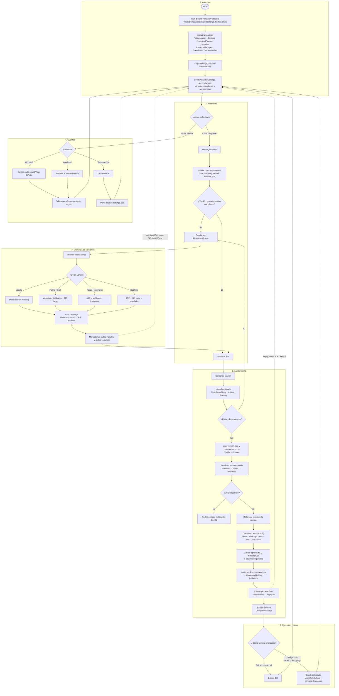
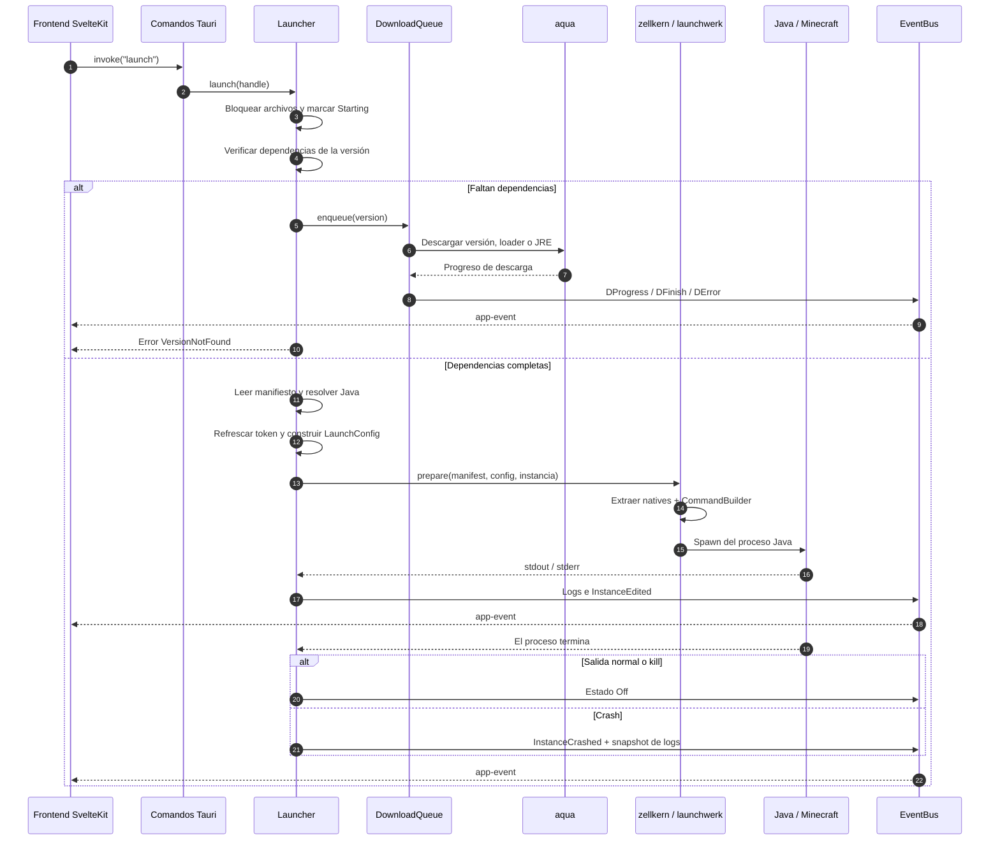

<p align="center">
  
</p>

<h1 align="center">CubicLauncher</h1>

CubicLauncher es un launcher de código abierto para Minecraft: Java Edition. Está pensado para tener varias instalaciones del juego separadas, cada una con su propia versión, configuración y contenido, sin que se pisen entre sí.

Está hecho con Tauri v2, Rust y SvelteKit, y funciona en Windows, Linux y macOS.

[](https://github.com/CubicLauncherDevs/CubicLauncher/actions/workflows/ci.yml)
[](https://github.com/CubicLauncherDevs/CubicLauncher/releases/latest)
[](https://github.com/CubicLauncherDevs/CubicLauncher/releases)
[](LICENSE)

Sitio web: <https://cubiclauncher.org>

# Instalación

- Las versiones estables están en [GitHub Releases](https://github.com/CubicLauncherDevs/CubicLauncher/releases).
- Estado de las últimas compilaciones: <https://github.com/CubicLauncherDevs/CubicLauncher/actions>

| Plataforma | Archivo                                                  |
| ---------- | -------------------------------------------------------- |
| Windows    | Instalador NSIS (`.exe`)                                 |
| Linux      | AppImage, `.deb` y `.rpm`                                |
| macOS      | `.dmg` (Apple Silicon e Intel)                           |

## Arch Linux

El paquete [`cubiclauncher`](https://aur.archlinux.org/packages/cubiclauncher) está en el AUR:

```bash
yay -S cubiclauncher
```

También hay un [PKGBUILD](dist/arch/PKGBUILD) si prefieres compilarlo localmente. En Arch conviene usar este paquete en lugar del binario de las releases, porque este último se compila en Ubuntu y puede no ser compatible con las bibliotecas de tu sistema.

## Nix y NixOS

Con `flakes` y `nix-command` activados, configura la caché pública de
[Cachix](https://cubiclauncher.cachix.org) para descargar los binarios publicados
para Linux x86_64 y ARM64:

```bash
nix run nixpkgs#cachix -- use cubiclauncher
```

En NixOS, incorpora la configuración generada siguiendo las indicaciones del
comando y aplica los cambios con `sudo nixos-rebuild switch` antes de instalar.
Si tu configuración usa un flake en Git, agrega también los archivos generados
al repositorio con `git add` para que Nix pueda leerlos.

Elige la versión estable o la beta:

```bash
# Última versión estable publicada en la caché
nix profile add github:CubicLauncherDevs/CubicLauncher/latest-release

# Alternativa: última beta publicada en la caché
nix profile add github:CubicLauncherDevs/CubicLauncher/latest-beta

# Ejecutar sin instalar
nix run github:CubicLauncherDevs/CubicLauncher/latest-release
```

También puedes instalar un tag específico reemplazando `TAG` por el nombre
exacto de la versión en [Releases](https://github.com/CubicLauncherDevs/CubicLauncher/releases):

```bash
nix profile add github:CubicLauncherDevs/CubicLauncher/TAG
```

Nix usa Cachix automáticamente si está disponible el build de esa revisión y
arquitectura; de lo contrario, compila localmente. Los canales `latest-release`
y `latest-beta` se actualizan cuando termina correctamente su publicación en
la caché; si un canal aún no se publicó, su tag puede no existir.

El flake ofrece paquetes para `x86_64-linux`, `aarch64-linux` y `aarch64-darwin`;
la caché del proyecto se publica solo para Linux. Más detalles y comandos de
actualización en la [guía de Nix](dist/nix/README.md).

Para ver en qué otras distribuciones está disponible, revisa [Repology](https://repology.org/project/cubiclauncher/versions).

## Docker

La imagen se publica en GitHub Packages para `linux/amd64` y `linux/arm64`:

```bash
docker pull ghcr.io/cubiclauncherdevs/cubiclauncher:latest
```

Como CubicLauncher es una aplicación de escritorio, el contenedor necesita
acceso al servidor gráfico del host. En X11:

```bash
xhost +si:localuser:$(id -un)
docker run --rm -it \
  --user "$(id -u):$(id -g)" \
  -e HOME=/data \
  -e DISPLAY \
  -v /tmp/.X11-unix:/tmp/.X11-unix:ro \
  -v cubic-data:/data \
  --device /dev/dri \
  ghcr.io/cubiclauncherdevs/cubiclauncher:latest
```

En Wayland:

```bash
docker run --rm -it \
  --user "$(id -u):$(id -g)" \
  -e HOME=/data \
  -e XDG_RUNTIME_DIR=/run/user/$(id -u) \
  -e WAYLAND_DISPLAY \
  -e GDK_BACKEND=wayland \
  -v "$XDG_RUNTIME_DIR:/run/user/$(id -u)" \
  -v cubic-data:/data \
  --device /dev/dri \
  ghcr.io/cubiclauncherdevs/cubiclauncher:latest
```

El volumen `cubic-data` conserva `~/.cubic` (instancias, ajustes y el JRE que
descarga el launcher). Para usar los datos del host, monta
`-v "$HOME/.cubic:/data/.cubic"`. La imagen funciona con cualquier UID gracias a
`--user`, pero el directorio `/data` debe ser escribible por ese UID (el volumen
se crea con permisos `1777`).

Notas:

- Con NVIDIA necesitas `nvidia-container-toolkit` y `--gpus all`. Si la interfaz
  aparece en blanco, añade `-e WEBKIT_DISABLE_DMABUF_RENDERER=1`.
- Para audio con PulseAudio monta el socket y define `PULSE_SERVER`; para ALSA
  usa `--device /dev/snd`.
- El actualizador integrado no funciona dentro del contenedor: actualiza
  cambiando la etiqueta de la imagen.
- Si WebKit falla al iniciar por el sandbox, prueba
  `--security-opt seccomp=unconfined`.

Para compilar la imagen localmente:

```bash
docker build -t cubiclauncher .
```

El workflow [`.github/workflows/docker.yml`](.github/workflows/docker.yml)
publica la imagen al crear un tag `v*`. Para sembrar la primera versión con el
último release publicado, ejecútalo manualmente desde
**Actions → Docker Image → Run workflow** y deja el campo `tag` vacío: se
resolverá automáticamente el último release estable (por ejemplo, `v36.0.1`) y
se compilará el código de ese tag, no el de la rama actual. También puedes
indicar un tag concreto; si no es el último release, no se moverá `latest`.

Las etiquetas publicadas son la versión (`36.0.1`), `36.0`, `36` y `latest`.
`latest` solo se mueve cuando se publica el release más reciente; las versiones
prerelease únicamente reciben su propia etiqueta. Si el paquete aparece privado,
cambia su visibilidad a pública en la configuración del paquete en GitHub.

# Qué puede hacer

- Crear, configurar, importar y exportar instancias.
- Instalar Vanilla, Fabric, Forge, Quilt y NeoForge.
- Iniciar sesión con Microsoft, Yggdrasil o jugar sin conexión.
- Buscar e instalar mods, resource packs y shaders desde Modrinth y CurseForge, e importar modpacks.
- Administrar mundos y listas de servidores por instancia.
- Elegir la versión de Java y su proveedor (Azul Zulu, Eclipse Temurin, BellSoft Liberica y GraalVM), ajustar la memoria y ver la consola de registros.
- Cambiar tema e idioma, y mostrar la actividad en Discord.

## Migrar desde otro launcher

Puedes copiar tus instancias desde el launcher oficial o desde MultiMC y sus forks (PolyMC, Prism Launcher, PineconeMC, Freesm Launcher). Los originales no se tocan.

1. Ve a **Crear instancia → Local → Migrar**.
2. Elige el launcher de origen y pulsa **Buscar instalaciones**. Si usas una instalación portable o una ruta personalizada, usa **Elegir carpeta**.
3. Selecciona las instancias que quieras y pulsa **Migrar**.

Se copian mundos, mods, configuraciones, packs, capturas, servidores y opciones. Las versiones y loaders se instalan después desde la cola de descargas, y las cuentas hay que configurarlas de nuevo en CubicLauncher. Los componentes desconocidos y los parches del juego base no son compatibles, y no se admiten enlaces simbólicos dentro de los datos copiados.

# Cómo funciona

CubicLauncher separa la interfaz del trabajo pesado. El frontend SvelteKit envía comandos al backend Tauri y este responde con eventos (`app-event`) y transmisiones de logs. Cada instancia guarda su configuración en `instance.cub`, mientras que los archivos compartidos (versiones, librerías, assets y JRE) viven en el directorio `shared`.

- `~/.cubic/instances/<nombre>/`: datos de la instancia y su archivo `instance.cub`.
- `~/.cubic/shared/`: `versions`, `libraries`, `assets`, `natives` y `runtimes`.
- `~/.cubic/settings/settings.cub`: ajustes, cuentas y preferencias.
- `~/.cubic/themes/` y `~/.cubic/skins/`: temas y skins del usuario.

## Flujo general



## Ciclo de lanzamiento



# Ayuda y soporte

Si necesitas ayuda, puedes abrir un [issue](https://github.com/CubicLauncherDevs/CubicLauncher/issues). Si no es un error, probablemente sea más rápido preguntar en Discord.

[](https://discord.gg/3xPwpUdPWT)

También tenemos un subreddit donde puedes dejar tus problemas y sugerencias:

[](https://www.reddit.com/r/CubicLauncher/)

Al reportar un error, incluye la versión del launcher, tu sistema operativo y los pasos para reproducirlo.

# Desarrollo

Si quieres contribuir, lee antes [CONTRIBUTING.md](CONTRIBUTING.md) y [TESTING.md](TESTING.md). Para charlar con el equipo, pasa por el Discord.

## Compilar

Necesitas:

- [Git](https://git-scm.com/)
- [Bun](https://bun.sh/)
- [Node.js](https://nodejs.org/) (una versión LTS)
- [Rust](https://www.rust-lang.org/tools/install) estable con edición 2024, junto con Cargo, rustfmt y Clippy
- Las [dependencias del sistema de Tauri v2](https://v2.tauri.app/start/prerequisites/) para tu plataforma

```bash
git clone https://github.com/CubicLauncherDevs/CubicLauncher.git
cd CubicLauncher
bun install --frozen-lockfile
bun run tauri dev
```

`bun run dev` levanta solo el frontend con Vite, pero lo que depende del backend no funcionará fuera de Tauri. Si usas Nix, corre `nix develop` primero.

| Comando                                   | Qué hace                                      |
| ----------------------------------------- | --------------------------------------------- |
| `bun run tauri dev`                       | Abre la app en modo desarrollo                |
| `bun run tauri build`                     | Compila y empaqueta para tu plataforma        |
| `bun run lint`                            | ESLint sobre el frontend                      |
| `bun run check`                           | Tipos y diagnósticos de Svelte                |
| `bun run test:all`                        | Tests del frontend y de Rust                  |
| `cargo fmt --all --check`                 | Revisa el formato de Rust                     |
| `cargo clippy --workspace -- -D warnings` | Análisis estático de Rust                     |

## Estructura

```text
src/          Frontend (interfaz, estado y servicios)
src-tauri/    Aplicación Tauri, comandos y servicios nativos
crates/       Bibliotecas internas del workspace de Rust
tests/        Tests del frontend
static/       Recursos estáticos
dist/         Archivos de empaquetado para distribuciones
.github/      CI y flujos de publicación
```

## Traducciones

Las traducciones se mantienen en el repositorio [Translations](https://github.com/CubicLauncherDevs/Translations). Ahí también está la información para colaborar.

## Versiones

El proceso de versionado y publicación está explicado en [VERSIONING.md](VERSIONING.md).

# Licencia

Todo el código del launcher se distribuye bajo la licencia [GPL-3.0-only](LICENSE).

La participación en el proyecto se rige por el [Código de conducta](CODE_OF_CONDUCT.md).
